# PawMatch - AI-Powered Lost & Found Pet Recovery

PawMatch is a Flask web application for sharing lost and found pet reports and reviewing possible matches using pet-image embeddings and location. It is a personal learning project that brings a machine-learning pipeline into a usable web interface.

The current UI combines a dark forest hero, an animated white puppy, centered neumorphic surfaces, Lucide icons, and a shared illustrated footer. See [design.md](design.md) for the current design notes and visual references.

---

## What It Does

1. Share a photo, pet details, location, and contact information.
2. Extract a 128-dimensional image embedding and geocode the address.
3. Compare the report with active reports of the same species and opposite report type.
4. Review up to five ranked suggestions and compare details with the listed contact.

Similarity scores are suggestions rather than confirmation of a pet's identity. Dates and appearance details are stored and displayed; the current route's scoring function does not apply time-based weighting.

---

## Features

### Lost & Found Reports

- Lost and found submissions with a pet photo, name, species, appearance, address, and contact phone.
- Local photo preview and native required-field validation.
- Pet cards with location, date, report type, and missing-photo fallback.
- Report management with Active, Reunited, and Resolved statuses.

### Authentication

- Registration, password hashing, sign-in, and Flask sessions.
- A user-specific My reports page.
- Raised navigation buttons with pressed feedback and an active-page indicator.

### AI Matching Pipeline

- An interchangeable detection interface; `AnimalDetector` currently returns an `unknown` stub result, so the submitted species is used.
- A ResNet-50 backbone with a 128-dimensional output layer and custom weights from `pet_embedder_resnet50.pth`.
- Image preprocessing and cosine visual similarity in `embeddings.py`.
- A native submission/redirect flow with a compulsory three-second paw animation before results are revealed. Processing starts immediately; slower searches do not receive an extra three-second delay.

Keep the trained weights in the project root. Missing weights cause the current code to fall back to untrained weights, which are unsuitable for meaningful visual matching.

### Geospatial Matching

Addresses are resolved through geopy's Nominatim client. Distance is calculated with the Haversine formula. When coordinates are unavailable, the route's matcher can award a location score for shared address words.

### Match Ranking

The Flask routes use `matcher.find_matches_for_report`, with a default limit of five results:

| Signal | Current behavior |
| --- | --- |
| Candidate eligibility | Same species, opposite Lost/Found type, Active status |
| Visual similarity | Up to 40 points |
| Geographic distance | 30 / 20 / 10 / 5 points within 2 / 5 / 15 / 30 km |
| Address fallback | 15 location points when at least two address words match and coordinates are unavailable |
| Baseline | 30 points for same-species candidates |
| Ordering | Descending total score, capped at 100 |

`geocoding.py` also contains a separate `rank_pet_matches` helper with different weights; it is not the ranking function called by the web routes.

### Notifications

A notification hook runs for a top score of at least 75 when a usable recipient email is available. SMTP settings in `notifications.py` are placeholders, and the current report form collects a phone number rather than an email address, so email delivery is not ready by default.

### Docker Support

The repository includes a Dockerfile and Compose services for PostgreSQL and the Flask app. The database service is useful for local development; see [Running with Docker](#running-with-docker) for the configuration differences in the web service.

### Interface and screenshots

The footer artwork keeps its original colors and proportions. Its sky blends with the light canvas, and the kindness message is centered above the sun and mountains. The Happy Dog animation remains in the home hero; the paw is reserved for match searches. Reduced-motion settings select still versions of both animations.

Screenshots below show the actual templates rendered in Chrome using fictional demo reports. They illustrate the interface, not live report data or evidence of model accuracy. No database reports were created for these captures.

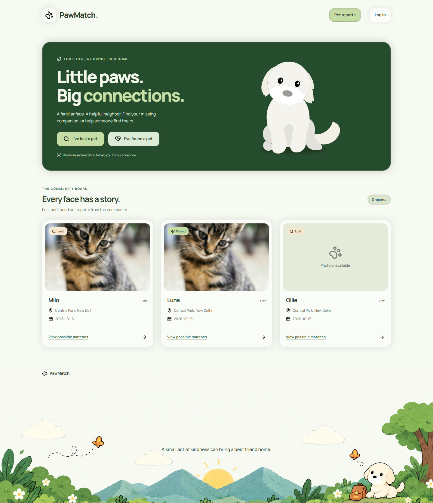

| Report a pet | Possible matches |
| --- | --- |
| 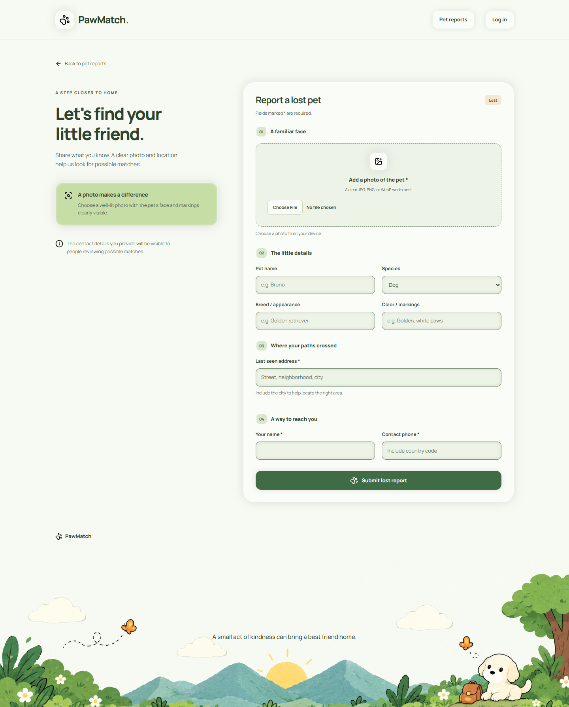 | 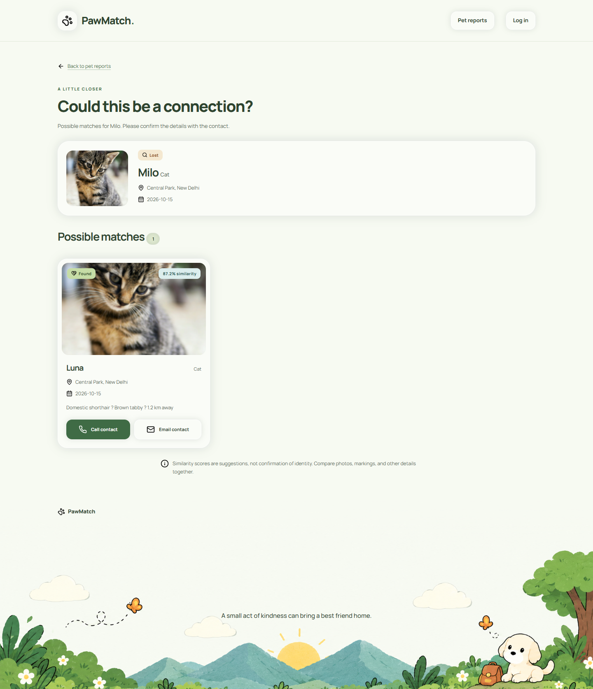 |

<details>
<summary>Mobile layout and matching animation</summary>

<p>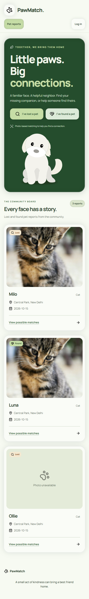</p>

<p>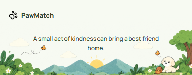</p>

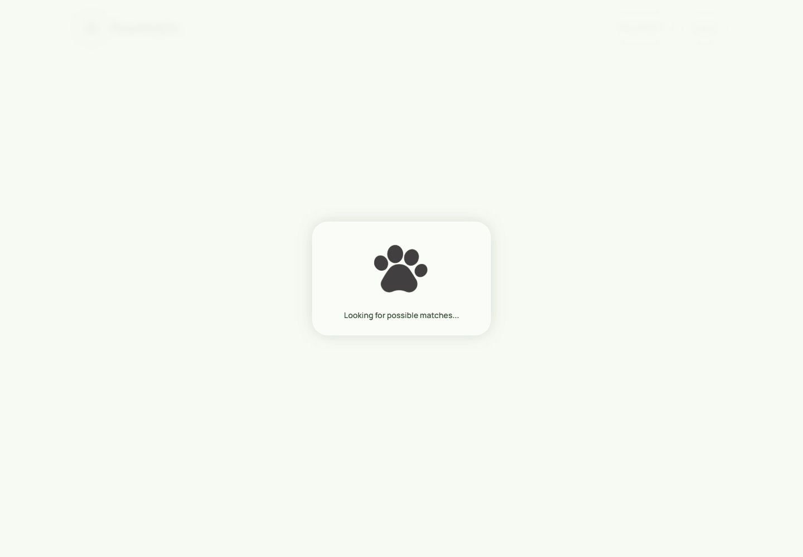

</details>

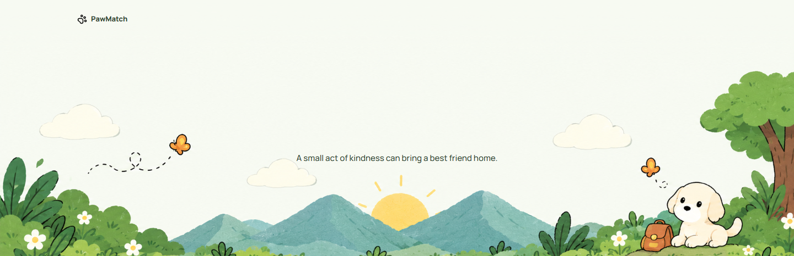

---

## Architecture


<details>
<summary>Flowchart source (Mermaid)</summary>

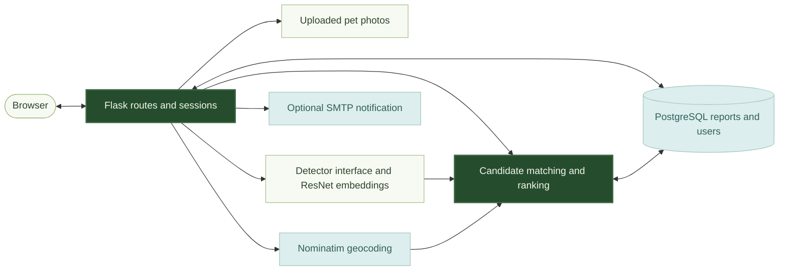

</details>

The web app, database helpers, model interface, embeddings, geocoding, matcher, and email hook remain separate modules. Templates share `base.html`, reusable UI macros, a single stylesheet, and the footer include.

---

## Tech Stack

| Area | Technology |
| --- | --- |
| Backend | Python, Flask |
| Database | PostgreSQL, psycopg2 |
| Embedding storage | JSON-encoded vectors; runtime expects a JSONB `image_vector` column |
| Machine learning | PyTorch, torchvision, ResNet-50 |
| Image processing | Pillow, NumPy |
| Geospatial processing | geopy / Nominatim, Haversine distance |
| Authentication | Flask sessions and Werkzeug password hashing |
| Notifications | smtplib / SMTP hook |
| Frontend | Jinja templates, shared CSS, vanilla JavaScript |
| Typography and icons | Manrope with system fallback, local Lucide SVGs |
| Artwork | Local SVG animations and original illustrated PNG footer |
| Containerization | Docker and Docker Compose |
| Runtime dependencies | `requirements.txt`; `pyproject.toml` also contains separate experiment dependencies |

---

## Project Structure

```text
pawmatch/
|-- app.py                      Flask routes and sessions
|-- database.py                 PostgreSQL access and account helpers
|-- schema.sql                  Fresh-database schema
|-- detector.py                 Current detection stub
|-- embeddings.py               ResNet loading and image vectors
|-- geocoding.py                Address resolution and distance helpers
|-- matcher.py                  Web route's candidate scoring
|-- notifications.py            SMTP notification hook
|-- pet_embedder_resnet50.pth    Custom model weights
|-- templates/
|   |-- base.html               Shared page shell
|   |-- ui.html                 Icons, cards, badges, and paw macro
|   |-- footer.html             Shared illustrated footer
|   |-- index.html
|   |-- login.html
|   |-- register.html
|   |-- report_form.html
|   |-- my_reports.html
|   `-- matches.html
|-- static/
|   |-- css/styles.css
|   |-- js/ui.js
|   |-- icons/                  Local Lucide SVGs and license
|   |-- animations/             Happy Dog and paw; animated/still variants
|   `-- images/footer.png       Byte-for-byte copy of original artwork
|-- assets/footer.png           Original footer source
|-- docs/
|   |-- references/             User-supplied design references
|   |-- diagrams/               Portable flowcharts and Mermaid sources in README
|   `-- screenshots/            Current UI screenshots with demo data
|-- uploads/                    Submitted photos, ignored by Git
|-- Dockerfile
|-- docker-compose.yml
|-- requirements.txt
|-- pyproject.toml
|-- uv.lock
|-- README.md
`-- design.md
```

`templates/style.css` is a legacy stylesheet; the current shared layout loads `static/css/styles.css`.

---

## Getting Started

### 1. Clone the repository

```bash
git clone https://github.com/anweshasingh-dev/pawmatch.git
cd pawmatch
```

### 2. Create a virtual environment

Use a Python version supported by your PyTorch installation. The included Dockerfile targets Python 3.11.

```bash
python -m venv .venv
```

**Windows PowerShell**

```powershell
.\.venv\Scripts\Activate.ps1
```

**Linux / macOS**

```bash
source .venv/bin/activate
```

### 3. Install dependencies

```bash
python -m pip install -r requirements.txt
```

Use `requirements.txt` for this Flask app. The current `pyproject.toml` and lockfile include a separate set of Streamlit/vision experiment dependencies and are not an equivalent Flask runtime manifest. Neither requirements file needs to change for the UI.

### 4. Configure environment variables

Create `.env` in the project root using the names read by `database.py`:

```dotenv
POSTGRES_DB=pawmatch
POSTGRES_USER=postgres
POSTGRES_PASSWORD=your_database_password
POSTGRES_HOST=localhost
POSTGRES_PORT=5432
```

When using the included Compose database, its configured password is `postgrespassword`. Keep local credentials in the ignored `.env` file.

### 5. Set up PostgreSQL

Create a `pawmatch` database, then initialize a **fresh/disposable database** with `schema.sql`. That file drops and recreates the users and reports tables, so do not rerun it against reports you want to keep.

```bash
createdb -U postgres pawmatch
psql -U postgres -d pawmatch -f schema.sql
```

The runtime saves an `image_vector`, but the current schema file does not define that column. Add it to your initialized database:

```bash
psql -U postgres -d pawmatch -c "ALTER TABLE reports ADD COLUMN IF NOT EXISTS image_vector JSONB;"
```

Alternatively, start PostgreSQL with the included Compose database service as described below. Existing database volumes still need the column if it has not already been added.

### 6. Run the application

```bash
python app.py
```

Open **[http://127.0.0.1:5000](http://127.0.0.1:5000)**. Keep the terminal running and use Ctrl+C to stop the server. If using an existing Windows environment without activating it:

```powershell
.\.venv\Scripts\python.exe app.py
```

For static styling updates, use Ctrl+Shift+R to reload cached assets.

The custom weights must remain in the project root. Geocoding needs internet access; the bundled SVGs, PNG, and icons are served locally. Manrope loads from Google Fonts with a system-font fallback.

---

## Running with Docker

Start Docker Desktop, then run the database service:

```bash
docker compose up -d db
```

On first initialization of an empty volume, the service applies `schema.sql`. Add the vector column expected by the current runtime:

```bash
docker compose exec db psql -U postgres -d pawmatch -c "ALTER TABLE reports ADD COLUMN IF NOT EXISTS image_vector JSONB;"
```

Use the local `.env` settings above with `POSTGRES_HOST=localhost` and `POSTGRES_PASSWORD=postgrespassword`, then start Flask locally with `python app.py`.

The included full-web-container setup remains a prototype: Compose passes `DB_*` variables while `database.py` reads `POSTGRES_*`. For a full container deployment, align those names, set the web service's `POSTGRES_HOST` to `db`, and verify the schema and image build. This documentation refresh does not modify Docker or dependency files.

---

## Design Approach

Keep the existing Flask routes and native forms while sharing presentation components. The dark hero highlights the white puppy; light cards and controls retain symmetric neumorphic depth. The footer is reused across all pages, with its original artwork and the message "A small act of kindness can bring a best friend home." centered above the sun.

The matching presentation runs alongside the request rather than delaying the algorithm:


<details>
<summary>Flowchart source (Mermaid)</summary>

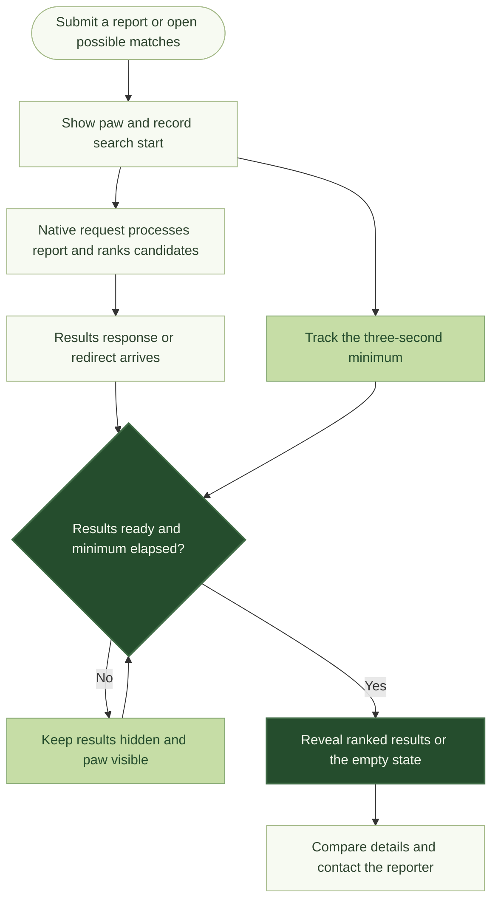

</details>

The paw does not appear during ordinary navigation, login, status updates, image loading, or startup. Direct results visits start their own three-second interval; reduced-motion users see a still paw for the same duration. Suggested matches always require human confirmation.

The current frontend was checked in Chrome with sample data, including responsive layouts, missing photos, native validation, navigation feedback, and matching-animation timing. Those checks are separate from end-to-end database, notification, and model-accuracy validation.

---

## Learning Goals

This project explores:

- Integrating image embeddings into a Flask workflow.
- Separating model code, geocoding, ranking, database access, and notifications.
- PostgreSQL account/report storage and JSONB image vectors.
- Sessions, hashed passwords, file uploads, and report status management.
- Responsive Jinja components, accessible controls, and reduced-motion artwork.
- Real browser verification of asynchronous presentation and visual states.

---

## Future Improvements

- Replace the detection stub with a trained detector and evaluate retrieval accuracy.
- Add date/metadata scoring if it improves measured matching quality.
- Consider pgvector or approximate nearest-neighbor search as report volume grows.
- Consolidate schema, dependency manifests, and Docker environment names.
- Connect the recipient-email flow and move SMTP configuration out of placeholders.
- Add full integration tests and deployment hardening before production use.

---

## Project Status

**Personal learning project with a completed UI refresh.**

The current interface includes shared components, responsive report forms, ranked match cards, a minimum-duration matching animation, and the illustrated footer. The backend remains an experimental implementation: detection is stubbed, notification configuration is incomplete, and fresh database/container setup needs the reconciliation documented above.

The screenshots show the final interface at the time of this update. They are demo captures, not a claim that all external integrations or matching accuracy have been validated.

---

## About

PawMatch explores how web development, databases, machine learning, geospatial processing, and interface design can work together to help reunite pets with their people.
