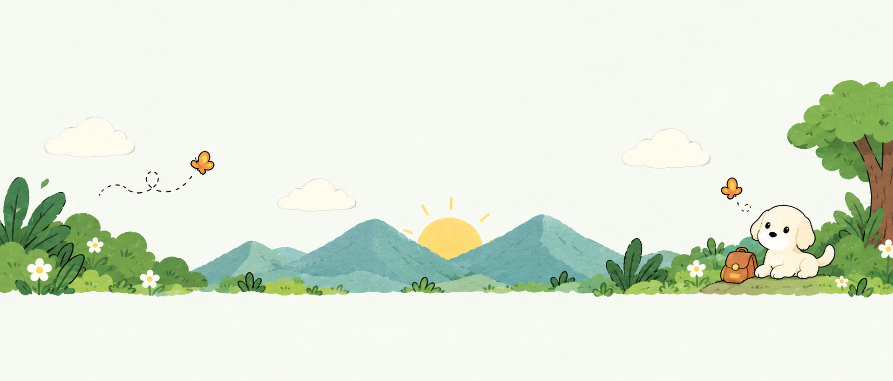
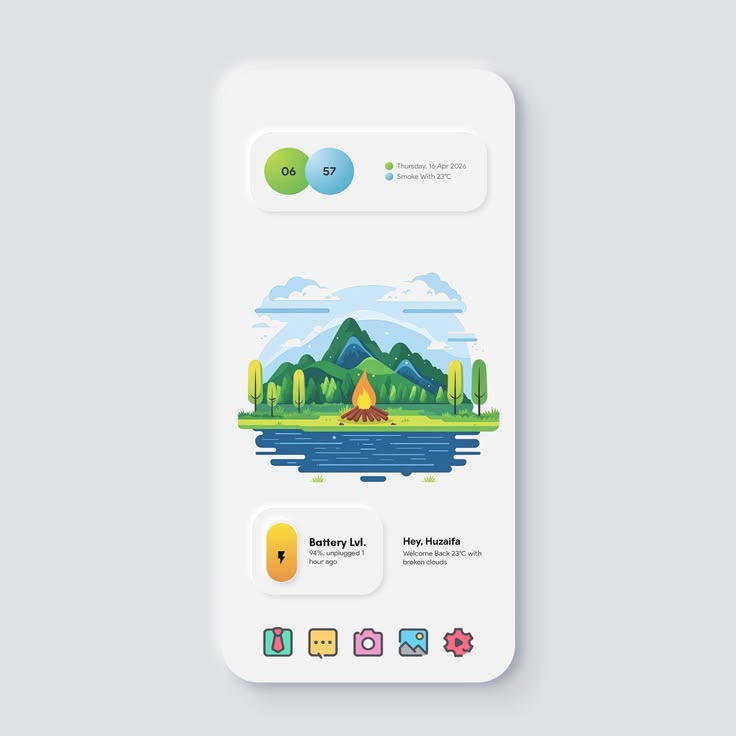
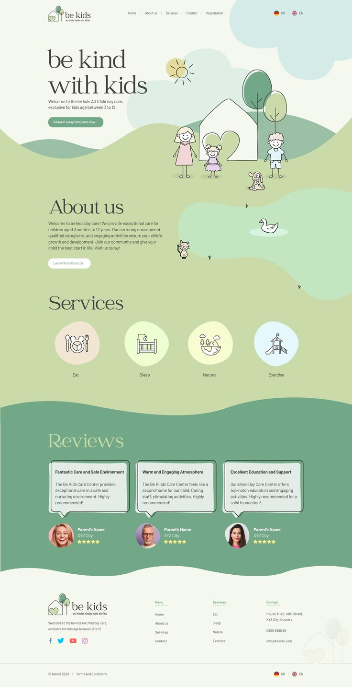
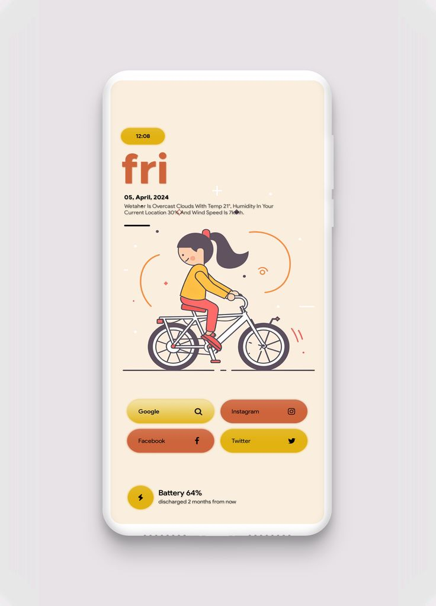

# PawMatch UI Design Plan

## Goal and scope

This document records the implemented PawMatch interface. Preserve the current Flask/Jinja structure, routes, native forms, matching behavior, and illustrated artwork. Changes should remain focused on presentation unless a separate backend task is explicitly requested.

The visual system combines centered neumorphism, a solid dark forest hero, pale green/cream surfaces, local Lucide icons, and the shared landscape footer. App screenshots belong in [README.md](README.md#interface-and-screenshots); this document contains the visual references and design decisions.

## Visual references

**Current palette anchor and footer artwork**

The original artwork remains unmodified in `assets/footer.png`, with an identical served copy at `static/images/footer.png`. Sampled open sky provides the current canvas color, `#F7FAF2`. Preserve the illustration's colors and proportions.

**Neumorphic form, spacing, and softness**

**Soft-green color direction**

**Earlier warm palette reference, retained as history**

Use these images for their stated purpose. Do not copy their page layouts, typography, or content. The solid dark hero requirement takes precedence over the lighter reference heroes, and the footer artwork now anchors the final palette.

## Reference direction

Keep rounded surfaces, restrained highlights, compact Manrope typography, and soft depth. All UI shadow layers have zero horizontal and vertical offset, so their effect surrounds each element evenly.

The animated white puppy sits directly against a solid forest background, without the former cream circle or floating labels. Pale sage and mint buttons remain distinct from that background. Light surfaces throughout the rest of the app align with the footer's sky, foliage, and mountain colors.

Keep the supplied Happy Dog, paw, and landscape artwork intact. Use pet photography in report cards; do not introduce decorative controls or fictional product metrics.

## Color system

| Token | Current value | Purpose |
| --- | --- | --- |
| Canvas | `#F7FAF2` | Median sampled footer sky; page background |
| Surface | `#FAFCF7` | Slightly raised light cards and controls |
| Inset surface | `#EDF3E6` | Fields, upload area, and preview background |
| Primary text | `#2E442F` | Dark foliage-green headings and copy |
| Secondary text | `#546753` | Muted green metadata and hints |
| Accent ink | `#3D6B43` | Links and section accents |
| Hero surface | `#254D2D` | Solid dark forest behind the white puppy |
| Hero text | `#F3F7EC` | Cream headline and focus outline |
| Hero metadata | `#D8E3D4` | Pale supporting text |
| Primary action | `#3F6B45` | Green buttons with white labels outside the hero |
| Primary hover | `#315636` | Darker green hover |
| Sage soft | `#C6DDA6` | Hero primary action, found/success fill, active navigation |
| Mint | `#DCEAD8` | Supporting hero action |
| Aqua soft | `#DCEEED` | Information and similarity badges |
| Aqua ink | `#315F5C` | Information text and focus outlines |
| Found ink | `#3B5732` | Text on pale sage |
| Lost background | `#F4E8D0` | Restrained warm lost/error fill |
| Lost ink | `#915327` | Lost/error text |
| Border | `#C7D3BF` | Quiet separators |
| Input boundary | `#778D70` | Visible field outline |

The latest refinement allows small saturation and brightness changes to match the footer. It lifts only the canvas, card surfaces, inset surfaces, and matching overlay; the dark hero and action colors stay in place. Original artwork is never recolored. Texture variations in the PNG are blended through empty-sky feathering rather than pixel editing.

## Typography and spacing

- Manrope weights 400, 500, 600, 700, and 800 load through Google Fonts; system sans-serif is the fallback.
- The current body is 15px with a 1.65 line height. Metadata and control labels use compact sizes suited to their hierarchy.
- The desktop hero headline is 57px, with responsive variants; general page headings are around 38px. Keep the established hierarchy rather than importing the reference site's serif font.
- Use the existing 4px spacing scale, primarily 8, 12, 16, 24, 32, and 48px.
- Shared content is capped at 1160px, with 32px intermediate and 18px mobile gutters.

## Surfaces and interaction

- Panels use generous rounded corners; buttons, fields, badges, and photo frames retain their current radii.
- Raised shadow: `0 0 24px rgba(56,79,59,.18), 0 0 8px rgba(255,255,255,.80)`.
- Smaller controls use the corresponding centered 14px/5px shadow pair.
- Inset shadow: `inset 0 0 8px rgba(56,79,59,.18), inset 0 0 3px rgba(255,255,255,.75)`.
- Hero actions use a centered dark/light shadow pair adapted to the forest background.
- Pet reports and Log in navigation links have raised, hover, pressed, keyboard-focus, and active-page states. `aria-current="page"` identifies the active route.
- Keep visible field boundaries and focus outlines. Never convey Lost/Found/status solely through color.
- Keep short transitions and respect reduced-motion preferences. Do not add artificial delays outside match searches.

## Lucide icons

Use local Lucide SVGs, currently sourced from release 0.468.0, through the `icon` macro in `templates/ui.html`. Keep the included license in `static/icons/LICENSE`. No React or icon CDN dependency is required.

| Context | Icons |
| --- | --- |
| Brand and empty states | `paw-print`, `clipboard-list` |
| Reporting actions | `search`, `heart-handshake` |
| Location and date | `map-pin`, `calendar-days` |
| Upload and matching | `image-plus`, `scan-search` |
| Navigation and session | `arrow-left`, `arrow-right`, `log-out` |
| Contact | `phone`, `mail` |
| Feedback | `circle-check`, `circle-alert`, `info` |
| Eyebrow accent | `leaf` |

Decorative icons have empty alternative text and are hidden from assistive technology. Important actions retain visible labels. Default icons are 20px, with smaller metadata variants.

## Page-by-page plan

### Shared shell - `templates/base.html`

The shared layout provides metadata, fonts, stylesheet/script links, navigation, flash notices, a skip link, and `#main`. It includes `templates/footer.html` on every page. Signed-out navigation contains Pet reports and Log in; registration remains accessible from the login form, with no Join the community button.

The shared footer keeps the PawMatch brand and the single message "A small act of kindness can bring a best friend home." centered above the sun and mountains. Both previous taglines are removed. The message is not duplicated on the home page. Artwork and text share one responsive canvas: copy remains clear of the puppy, foliage, clouds, and landscape.

### Home feed - `templates/index.html`

The dark forest hero contains the two reporting actions and the unmodified Happy Dog animation. The former paw medallion, helping-hand chip, closer-to-home chip, and cream circle are absent. Report cards use a three/two/one-column responsive grid, with explicit type, species, location, date, and a possible-matches link. Empty and missing-photo states are implemented.

### Report form - `templates/report_form.html`

The current single-page form groups photo, pet details, location, and contact information. Labels are associated with native fields, required inputs retain browser validation, and uploads have a local preview. Pet/contact fields stack on small screens. Valid report submission starts matching feedback without delaying the request.

### Match results - `templates/matches.html`

The template consumes the route's `target` and `matches` context and renders each `candidate_report` using the shared card macro. It shows the submitted pet, actual supplied scores/distances, available contact actions, and a no-results state. Similarity is labeled as a suggestion requiring confirmation.

### My reports - `templates/my_reports.html`

Each report row contains a thumbnail, details, type, status, match link, and one status-update form. Actions stack on mobile. Native field names, form methods, and status destinations remain intact.

### Authentication - `templates/login.html` and `templates/register.html`

Both use a compact centered panel, labeled fields, native validation, and a forest primary action. Login links to registration and registration links back to login. Shared flash messages handle feedback.

## Implementation sequence

The UI refresh followed this order; use the same sequence when checking a future visual change:

1. Inspect route context, native field contracts, and signed-in/signed-out states.
2. Establish shared color, type, spacing, shadow, and icon primitives.
3. Apply the shell and home hero, then cards, forms, and account pages.
4. Share the footer and preserve the supplied art's proportions and colors.
5. Verify empty/error/missing-photo states, match-loading timing, and reduced motion.
6. Review mobile/desktop screenshots and check that unrelated behavior is unchanged.

## Technical approach

The current app uses Flask-served assets: `static/css/styles.css` and `static/js/ui.js`. Tailwind CDN and inline dark-template styling have been removed from the active layout. `templates/style.css` remains as an unlinked legacy file.

`templates/ui.html` shares icons, photos, badges, pet cards, and the paw animation macro. `templates/footer.html` is included by the shared base. Changes should preserve field names, form methods, URL generation, session conditions, and uploaded-file serving. No framework migration or backend rewrite is part of this UI work.

## Completion checklist

- [x] Shared palette, rounded surfaces, and centered raised/inset shadows across pages.
- [x] Local Lucide icons and a working system-font fallback.
- [x] Responsive browser checks at 360px, 768px, 1024px, and 1440px during the UI refresh; latest captures at 390px and 1440px.
- [x] Native labels/required validation, visible focus, explicit status labels, and reduced-motion artwork.
- [x] Empty lists, missing photos, report-photo preview, and navigation feedback checked.
- [x] Match-search timing checked for fast responses, slow responses, native submissions, redirects, and direct results visits.
- [x] Footer text centered over the sky, clear of artwork, and present once per page.
- [x] README contains current app screenshots with an explicit demo-data caption.
- [ ] Full live database, account, email, and ML-quality integration validation remains separate work.

## Implementation notes

- Happy Dog is local SVG artwork with an animation-preserving viewBox adjustment that removes empty canvas only. A still SVG is selected for reduced motion.
- The paw uses local animated/still SVGs and appears only during match searches.
- The footer PNG is a byte-for-byte copy of `assets/footer.png`; its source dimensions are 1918x820.
- The footer fills the viewport width without outer side margins or bottom padding. Its display ends at source row 620, removing the pale ground fringe so the landscape reaches the page bottom; the original image file and intrinsic proportions remain unchanged.
- Text is layered over the sky. The message is horizontally centered, with its lower edge anchored just above source y=400; the sun's upper rays begin below it.
- The sky extends on mobile to fit readable copy. A mask feathers only empty sky (source y=0..150); the visible ground stays opaque to the bottom edge.
- Shared content alignment, native forms, route destinations, and the three-second presentation gate remain unchanged by the final color refinement.

## UI validation completed

Chrome checks used an isolated Flask template preview with fictional reports and no database writes. During the refresh they covered populated/empty pages, local assets, image fallbacks, native validation, photo preview, account-navigation variants, and report status destinations. Browser screenshots were reviewed at desktop and mobile sizes.

The footer was checked across eight page states at 360px, 768px, and 1440px: its message appears once, is horizontally centered over the sun, stays clear of the brand and illustrated details, and creates no horizontal scrolling. Source-image identity and intrinsic proportions were verified. Centered shadows were checked from computed CSS.

After the footer-sky refinement, body text, metadata, and primary-button color pairs were recalculated above 4.5:1; the field boundary remained above 3:1. Contrast alone is not a complete accessibility audit. Full database, SMTP, authentication, and model-accuracy integration tests were not part of these template captures.

## Paw loading component

The paw is reserved for report submissions and possible-match navigation. It does not replace ordinary browser loading, appear on startup, or animate for login, status updates, photos, or upload previews.

A search timestamp in per-tab session storage carries elapsed time through native navigation and redirects. Fast results remain hidden for the remainder of the compulsory three seconds; slower responses are shown once ready. Direct results visits start a fresh interval. No dismiss button or Escape shortcut bypasses the minimum. Reduced-motion users see a still paw for the same time. Back navigation restores existing controls without starting a fresh search.

## Warm palette and centered-shadow verification

This heading records the earlier warm-palette pass, which is now superseded by the green/footer palette. Its lasting requirement is centered depth: zero horizontal and vertical shadow offsets for panels, fields, controls, and match feedback. Do not restore the former mustard/terracotta theme as the main interface palette.

## Latest palette refinement

The latest permitted adjustment includes saturation and brightness, superseding the earlier hue-only restriction. The canvas is now `#F7FAF2`, sampled from the footer sky; raised surfaces are `#FAFCF7`, and inset surfaces are `#EDF3E6`. This reduces the visible boundary around the landscape while preserving the solid `#254D2D` forest hero, existing green actions, and centered shadows.

The supplied SVG/PNG artwork, layout, navigation effects, requirements files, matching algorithm, and loading duration remain unchanged. See the current color table above for the values used by the shared stylesheet.

## Footer copy and hue alignment

Retain the PawMatch brand plus exactly one message: "A small act of kindness can bring a best friend home." The message belongs inside the shared illustrated footer, centered above the sun and mountains on all pages. The old community/technology and made-for-the-ones-we-love taglines remain removed.

Use the original footer's sky, foliage, mountains, and sun as the color anchor. Small saturation/value corrections are now allowed to harmonize the UI; artwork recoloring is not required. Maintain the original proportions, responsive sky spacing, safe blank-area feathering, and centered neumorphic depth.
